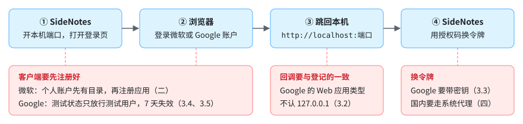
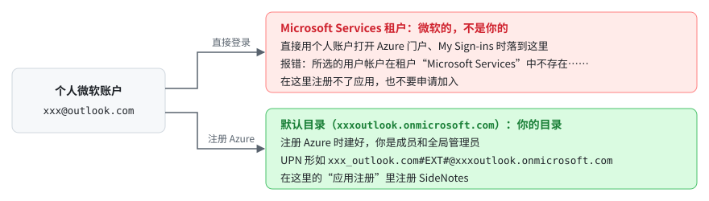
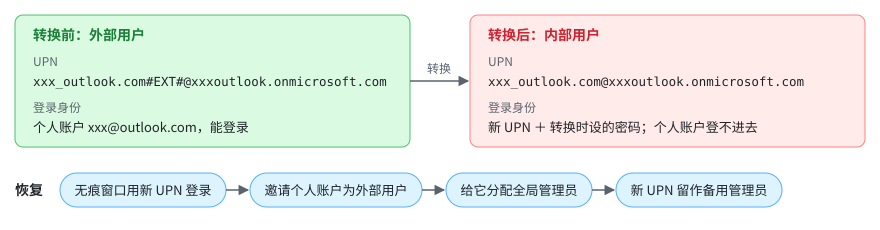
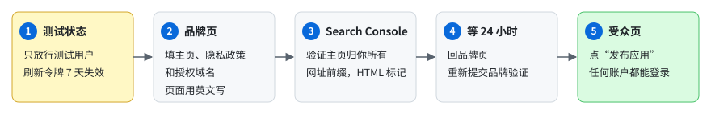

# OneDrive 与 Google Drive 登录配置的坑

本文汇总 SideNotes 接入 OneDrive、Google Drive 登录时踩过的坑，按报错给出原因和解决办法。

登录用的 OAuth 客户端由发布者注册一次，写进 `src-tauri/oauth-clients.json`，用户只管点“登录”（技术决策第 66 条）。客户端要自己注册，不能借用别的应用的（技术决策第 65 条）。重新注册客户端、换开发者账户或排查登录失败时，先看本文。

截至 2026-11-23：

- OneDrive：客户端已注册，登录、同步与恢复已实测。
- Google Drive：客户端已注册，用测试用户实测了登录、同步与恢复。同意屏幕仍是测试状态，品牌验证待重新提交（T173）。

文中的“截图占位”待补真实截图：按占位里的文件名存进 `docs/assets/`，再把占位换成图片引用。仓库是公开的，截图里的邮箱、租户 ID、对象 ID 和密钥要打码。

## 一、哪里会出错

点“登录”后，SideNotes 在本机开一个端口，用浏览器打开登录页。用户登录后，浏览器带着授权码跳回本机，应用再用授权码换令牌。下图标出每一步的坑，括号里是对应的小节。

按报错查：

| 报错或现象 | 原因 | 见 |
| --- | --- | --- |
| 所选的用户帐户在租户“Microsoft Services”中不存在⋯⋯ | 个人账户还没有目录，或打开了工作账户专用的页面 | 2.1、2.3 |
| 你没有资格使用 Azure 免费帐户 | 免费额度的资格被拒，不影响注册应用 | 2.2 |
| 所选的用户帐户在租户“默认目录”中不存在⋯⋯ | 把自己转换成了内部用户，又用个人账户登录 | 2.4 |
| 个人账户已是全局管理员，仍看不到订阅或免费额度 | 没切换到“默认目录”，或订阅、计费的权限没交接 | 2.5 |
| 错误 400：`redirect_uri_mismatch` | 回调地址与客户端登记的不一致 | 3.2 |
| `client_secret is missing.` | 换令牌时没带客户端密钥（桌面应用类型也要） | 3.3 |
| 错误 403：`access_denied` | 登录的账户不是测试用户 | 3.4 |
| Google Drive 登录 7 天后失效 | 同意屏幕还是测试状态 | 3.4 |
| 浏览器里登录成功，应用报“网络不通：连接超时” | 应用的请求没走系统代理 | 四 |
| 选远程文件夹时，看不到 Google Drive 原有的文件夹 | `drive.file` 只看得到应用自己建的文件 | 3.6 |

## 二、OneDrive（Microsoft Entra）

### 2.1 个人账户要先有自己的目录

自 2024 年 6 月起，微软只允许在目录（租户）里注册新应用，而个人账户（Outlook、Hotmail）本身不带目录。

直接用个人账户打开 Azure 门户，会落到微软自己的“Microsoft Services”租户，报下面的错。报错里的应用程序 `c44b4083` 就是 Azure 门户。

> 所选的用户帐户在租户“Microsoft Services”中不存在，且无法访问该租户中的应用程序“c44b4083-⋯⋯”。需要先将该帐户添加为该租户的外部用户。请使用其他帐户。

解决办法是用个人账户注册 Azure。注册时会建一个名为“默认目录”的目录，你是其中的全局管理员，应用就注册在这里。不要申请加入“Microsoft Services”。

### 2.2 注册 Azure 时的国家/地区与免费账户

- 国家/地区按付款方式的账单地址如实选，注册后不能改。全球版与世纪互联运营的中国版是两套云，SideNotes 用的是全球版（`login.microsoftonline.com`）。
- 提示“你没有资格使用 Azure 免费帐户”时，不必开通即用即付，注册应用不需要订阅。这次出现提示时，目录已经建好（目录里的用户比提示早 2 分钟创建）。先到 Entra 管理中心的“管理租户”确认有“默认目录”。

> **截图占位** `entra-manage-tenants.png`：“管理租户”列表里有一行“默认目录（默认）”，租户类型是“工作人员”。打码：域名前缀、组织 ID。

### 2.3 多重验证在微软账户的安全页打开

从 2024 年 10 月起，登录 Azure 门户和 Entra 管理中心必须通过 MFA（Multi-Factor Authentication，多重验证）。个人账户在[微软账户的安全页](https://account.microsoft.com/security)打开“两步验证”即可。

> **截图占位** `msa-two-step.png`：微软账户安全页里的“两步验证”一项，状态是已打开。打码：邮箱、手机号。

不要去 My Sign-ins（`mysignins.microsoft.com`）添加验证方式。那是工作或学校账户的页面，个人账户打开会报 2.1 那样的错，应用程序是 `19db86c3`。

### 2.4 不要把自己转换为内部用户

注册 Azure 后，个人账户在“默认目录”里是成员。它的 UPN（User Principal Name，用户主体名称）带 `#EXT#`，页面写着“当前用户是外部用户”。这是正常状态，全局管理员照样能注册应用。

> **截图占位** `entra-user-external.png`：“Entra ID › 用户”里个人账户的详情页。要看清 UPN 里的 `#EXT#`、用户类型“成员”，以及“B2B 协作”卡片里的“转换为内部用户”，把它框出来并标“不要点”。打码：邮箱、对象 ID。

点了“转换为内部用户”，这个用户就改由目录自己认证，个人账户登不进去了。再登录报“所选的用户帐户在租户‘默认目录’中不存在⋯⋯”，应用程序是 `74658136`（Entra 管理界面），像是死循环。

恢复步骤：

1. 打开无痕窗口，用转换时填的新 UPN 和当时设的密码登录，账户类型选“工作或学校帐户”。
2. 想继续用个人账户登录，按 2.5 把它邀请回目录，再交接权限。
3. 新 UPN 的账户留作备用，不要删除。

### 2.5 把权限交接给主账户

下文的“主账户”指平时用的个人账户 `xxx@outlook.com`，“备用账户”指转换后的 `xxx_outlook.com@xxxoutlook.onmicrosoft.com`。没转换过的个人账户本来就有下面三层权限，不用交接。

权限分三层，互相独立。主账户当了全局管理员，仍看不到订阅和免费额度，就是因为后两层没交接。

| 层 | 管什么 | 要给的角色 | 在哪里分配 |
| --- | --- | --- | --- |
| 目录 | 用户、应用注册 | 全局管理员 | Entra 管理中心：Entra ID › 角色和管理员 |
| 订阅 | 订阅里的资源 | 所有者 | Azure 门户：订阅 › 访问控制（IAM） |
| 计费 | 账单、付款方式、免费额度 | 计费帐户所有者 | Azure 门户：成本管理 + 计费 › 计费账户 › 访问控制（IAM） |

免费额度挂在计费配置文件上。计费帐户所有者的权限会继承到下面的计费配置文件，所以计费这一层给这一个角色就够了。

下面四步都用备用账户操作。第（1）（2）步已实测；第（3）（4）步按微软文档整理，未实测。

**（1）把主账户邀请进目录**

1. 在 [Entra 管理中心](https://entra.microsoft.com)打开“Entra ID › 用户”，选“新建用户 › 邀请外部用户”。
2. 填主账户的邮箱，勾选“发送邀请消息”，点“审阅和邀请”，再点“邀请”。
3. 主账户的邮箱会收到 Microsoft Invitations 发来的邮件，点“接受邀请”，再点“接受”。

> **截图占位** `entra-invite-external.png`：“新建用户”菜单展开、选中“邀请外部用户”；表单里的“电子邮件”和“发送邀请消息”。打码：邮箱。

**（2）目录：全局管理员**

在“Entra ID › 角色和管理员”里点角色名“全局管理员”（点名字，不要勾选），点“添加分配”，选中主账户后确认。

> **截图占位** `entra-global-admin.png`：“全局管理员”的分配列表，有主账户和备用账户两行，顶部是“添加分配”。打码：邮箱。

**（3）订阅：所有者**

1. 在 [Azure 门户](https://portal.azure.com)打开“订阅”，点注册时建的那个订阅，再点“访问控制（IAM） › 添加 › 添加角色分配”。
2. 在“特权管理员角色”页签选“所有者”，在“成员”页签选中主账户。
3. 在“条件”页签选“允许用户分配所有角色（高特权）”。标着“推荐”的那一项不让主账户再分配所有者等特权角色。
4. 点“审阅 + 分配”。

> **截图占位** `azure-owner-condition.png`：“添加角色分配”的“条件”页签，“允许用户分配所有角色（高特权）”被选中。

**（4）计费：计费帐户所有者**

1. 在 Azure 门户搜索“成本管理 + 计费”，在“计费范围”里选类型为“Microsoft 客户协议”的计费账户。
2. 点“访问控制（IAM） › 添加”，角色选“计费帐户所有者”，选中主账户，点“添加”。

> **截图占位** `billing-account-owner.png`：计费账户的“访问控制（IAM）”列表，主账户的角色是“计费帐户所有者”。打码：邮箱、计费账户 ID。

备用账户登不进去时，只要主账户已是全局管理员，也能自己补上后两层。

- 订阅：在 Entra 管理中心的“Entra ID › 属性”里，把“Azure 资源的访问管理”设为“是”并保存，退出再登录。这时主账户在根范围有“用户访问管理员”角色，去订阅的“访问控制（IAM）”给自己分配“所有者”，再把开关设回“否”。
- 计费：全局管理员能读目录里所有“Microsoft 客户协议”的计费账户。在“计费范围”页勾选查看全部计费账户，选中这个计费账户，按第（4）步给自己加“计费帐户所有者”。

两个账户都不是全局管理员时，只能找微软支持恢复管理员权限。

交接完，用无痕窗口以主账户登录 Azure 门户验证。主账户在目录里是来宾，要先从右上角的账户菜单“切换目录”到“默认目录”，才看得到订阅和计费账户。

> **截图占位** `azure-switch-directory.png`：Azure 门户右上角账户菜单里的“切换目录”，目录列表里选中“默认目录”。打码：邮箱、域名前缀。

- 订阅：主账户能打开“访问控制（IAM）”，角色是“所有者”。
- 计费：在“成本管理 + 计费”里选中计费账户，“计费 › 付款方式”的“Azure 额度”页签显示可用余额。
- 目录：Entra 管理中心能打开“应用注册”。

> **截图占位** `billing-azure-credits.png`：主账户看到的“Azure 额度”页签，显示可用余额。打码：计费账户名称。

备用账户保留全局管理员，平时不用，记好密码和多重验证方式。微软建议至少留两个紧急访问账户，用 `*.onmicrosoft.com` 的纯云账户，备用账户正是这种。主账户三层都验证通过之前，不要删掉备用账户的任何角色。

### 2.6 注册应用

在 Entra 管理中心的“应用注册”里新注册一个应用，按下表设置。

| 设置 | 选什么 | 为什么 |
| --- | --- | --- |
| 受支持的帐户类型 | 任何组织目录中的帐户和个人 Microsoft 帐户 | 默认选中的是“仅此组织目录”，个人账户登录不了 |
| 重定向 URI | 平台选“公共客户端/本机（移动和桌面）”，填 `http://localhost` | 微软对 localhost 不比较端口；门户里填不进 `http://127.0.0.1` |
| API 权限 | Microsoft Graph 的委托权限 `Files.ReadWrite`、`User.Read`、`offline_access` | 少了 `offline_access` 拿不到刷新令牌 |

注册后，把“应用程序（客户端）ID”填进 `src-tauri/oauth-clients.json` 的 `onedrive.clientId`，`tenant` 保持 `common`。

## 三、Google Drive（Google Cloud）

### 3.1 建客户端，类型选“桌面应用”

1. 在 [Google Cloud 控制台](https://console.cloud.google.com)新建项目，在“API 和服务”的“库”里启用 Google Drive API。
2. 在 Google Auth Platform 里，受众选“外部”，数据访问里加范围 `https://www.googleapis.com/auth/drive.file`，再把自己的账户加为测试用户。
3. 在[客户端页](https://console.cloud.google.com/auth/clients)新建 OAuth 客户端，类型选“桌面应用”。
4. 把客户端 ID 写进 `src-tauri/oauth-clients.json` 的 `google.clientId`；密钥用[开发与验证命令](./tasks.md#开发与验证命令)里的命令异或后写进 `google.obscured`（明文会被密钥扫描报为泄露，见 3.3）。

> **截图占位** `google-create-client.png`：新建 OAuth 客户端的页面，“应用类型”下拉框选中“桌面应用”，名称填 SideNotes。

桌面应用类型不用登记重定向 URI，`localhost` 与 `127.0.0.1` 的任意端口都认（2026-11-23 实测）。Google 文档写桌面应用换令牌、刷新令牌时 `client_secret` 可选，实测不成立，见 3.3。

2026-11-23 起用的是“桌面应用”类型的客户端。之前的客户端是“Web 应用”类型（当初想的是以后与安卓共用），已删掉。其实安卓要另建“Android”类型的客户端，填包名和签名证书的 SHA-1。同一项目里的客户端共用同意屏幕、品牌验证和测试用户，选哪种都不妨碍安卓。

### 3.2 回调地址用 localhost

Web 应用类型只认登记过的回调地址。之前的 Web 应用客户端登记了 `http://localhost`，实测结果如下。

- `http://localhost:任意端口`：能登录。
- `http://127.0.0.1:端口`、`http://[::1]:端口`、带路径的地址：报 `redirect_uri_mismatch`。

所以两家的回调都用 `http://localhost:随机端口`，并在 `127.0.0.1` 与 `::1` 上监听同一个端口（`src-tauri/src/cloud/oauth.rs`）。桌面应用类型两种地址都认，换类型不用改代码。

Google 的文档要求 Web 应用的回调与登记的完全一致，“认 localhost 的任意端口”只是实测结果。现在已换成桌面应用类型的客户端。

### 3.3 客户端密钥省不掉，桌面应用类型也一样

PKCE（Proof Key for Code Exchange，代码交换证明密钥）代替不了客户端密钥。不带 `client_secret` 请求令牌接口，Web 应用与桌面应用类型的客户端都返回 `client_secret is missing.`；桌面应用类型是 2026-11-23 实测的，换令牌与刷新令牌都这样，Google 的文档写的是“可选”。

密钥编进安装包，谁都能读出来，Google 也认为桌面应用的密钥不算机密。可明文写进仓库会被 GitHub 与 GitGuardian 报为泄露，所以 `oauth-clients.json` 里存的是异或后的十六进制（`google.obscured`），构建时由 `src-tauri/build.rs` 还原（技术决策第 74 条）；之前明文写进仓库的 Web 应用客户端密钥已从仓库历史里抹掉，那个客户端也已删除。当时是明文：推送时 GitHub 的推送保护拦下了客户端 ID 与密钥，按提示的链接标为误报后才推上去，之后 GitHub 与 GitGuardian 发邮件报泄露。

### 3.4 测试状态只放行测试用户

同意屏幕在测试状态时，有两个限制。

- 只有[受众页](https://console.cloud.google.com/auth/audience)里加过的测试用户能登录，其他账户报错误 403：`access_denied`。
- 刷新令牌 7 天后失效，到时要重新登录。

> **截图占位** `google-audience.png`：受众页的发布状态“测试”和“发布应用”按钮，下面的“测试用户”列表和“添加用户”。打码：邮箱。

发布应用后才没有这两个限制，见 3.5。

### 3.5 发布前要过品牌验证

只用 `drive.file` 不必审核权限范围，但发布前仍要过品牌验证。

1. 在[品牌页](https://console.cloud.google.com/auth/branding)填主页、隐私政策链接和授权域名。删掉徽标也免不了这一步。SideNotes 填的是 `https://limuhua.github.io/SideNotes/`、同目录下的 `privacy.html` 和 `limuhua.github.io`（技术决策第 68 条）。
2. 用建项目的那个 Google 账户，在 [Search Console](https://search.google.com/search-console) 验证主页归你所有：资源类型选“网址前缀”，验证方式选“HTML 标记”。
3. 验证通过 24 小时后，在品牌页的“Branding verification issues”里选“I have fixed the issues”，点“Proceed”。
4. 品牌验证通过后，在受众页点“发布应用”。

> **截图占位** `google-branding.png`：品牌页的主页、隐私政策链接、授权域名三项，以及“Branding verification issues”里的“I have fixed the issues”和“Proceed”。

> **截图占位** `search-console-html-tag.png`：Search Console 添加资源时选“网址前缀”，验证方法展开“HTML 标记”，带“验证”按钮。标记本来就公开在网页上，不用打码。

第一次品牌验证报了六条问题。第一条是主页所有权，由第 2 步解决。其余五条是隐私政策内容不够、主页在登录页后面、没说明用途、应用名与主页对不上、不合规，多半因为当时的页面以中文为主。

所以主页和隐私政策改成英文版放在原地址，写明应用名、用途和“How SideNotes uses Google user data”。隐私政策写全了九节，含 Google API 的有限使用（Limited Use）声明。中文版移到 `docs/home-page/public/zh/`（技术决策第 71 条）。

截至 2026-11-23，第 3、4 步还没做：要等重做的官网（T178）上线后再提交，能否通过还不知道。

### 3.6 drive.file 看不到原有的文件夹

`drive.file` 只让应用看到它自己建的文件和文件夹，远程文件夹的选择框里列不出网盘原有的文件夹。存快照的文件夹要在选择框里新建，它与网盘里原有的同名文件夹是两个文件夹。

## 四、国内要让应用走系统代理

国内要经代理才连得上 Google。浏览器走系统代理，能登录、能跳回本机；应用的请求不走代理，拿授权码换令牌时就报“网络不通：连接超时”。

`src-tauri/Cargo.toml` 里的 reqwest 关了默认特性，读系统代理的 `system-proxy` 要单独打开。现在 OneDrive、Google Drive 和 Resend 的请求同浏览器一样走系统代理，群晖 NAS 直连（技术决策第 69 条）。

## 五、参考链接

- [AADSTS50020：标识提供者中的用户帐户不存在](https://learn.microsoft.com/zh-cn/troubleshoot/entra/entra-id/app-integration/error-code-aadsts50020-user-account-identity-provider-does-not-exist)，微软
- [Azure 强制多重验证](https://learn.microsoft.com/zh-cn/entra/identity/authentication/concept-mandatory-multifactor-authentication)，微软
- [把外部用户转换为内部用户](https://learn.microsoft.com/zh-cn/entra/identity/users/convert-external-users-internal)，微软
- [添加来宾用户并发送邀请](https://learn.microsoft.com/zh-cn/entra/external-id/b2b-quickstart-add-guest-users-portal)，微软
- [了解 Microsoft 客户协议的计费角色](https://learn.microsoft.com/zh-cn/azure/cost-management-billing/manage/understand-mca-roles)，微软
- [全局管理员提升访问权限以管理计费帐户](https://learn.microsoft.com/zh-cn/azure/cost-management-billing/manage/elevate-access-global-admin)，微软
- [全局管理员提升访问权限以管理所有 Azure 订阅](https://learn.microsoft.com/zh-cn/azure/role-based-access-control/elevate-access-global-admin)，微软
- [管理紧急访问帐户](https://learn.microsoft.com/zh-cn/entra/identity/role-based-access-control/security-emergency-access)，微软
- [重定向 URI 的限制（localhost 例外）](https://learn.microsoft.com/zh-cn/entra/identity-platform/reply-url)，微软
- [桌面应用的 OAuth 2.0](https://developers.google.com/identity/protocols/oauth2/native-app)，Google
- [Google Drive API 的权限范围](https://developers.google.com/workspace/drive/api/guides/api-specific-auth)，Google
- [刷新令牌的失效条件](https://developers.google.com/identity/protocols/oauth2#expiration)，Google
- 项目内：[技术决策](./decisions.md)第 63～71 条，[开发任务](./tasks.md) T169、T173
