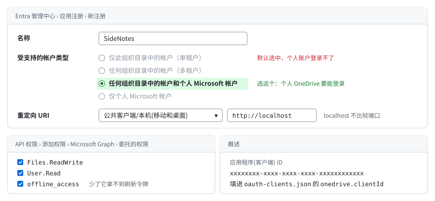
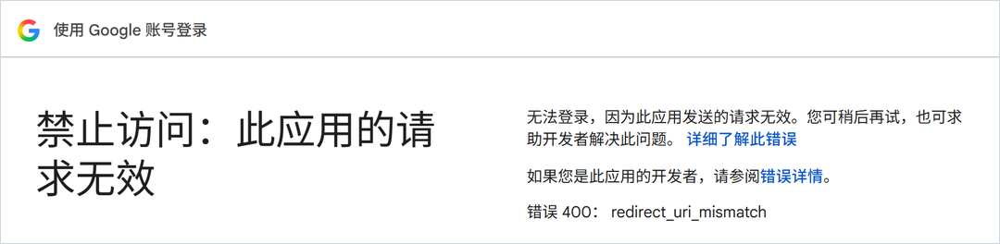

# OneDrive 与 Google Drive 登录配置的坑

本文汇总 SideNotes 接入 OneDrive、Google Drive 登录时踩过的坑，按报错给出原因和解决办法。

登录用的 OAuth 客户端由发布者注册一次，写进 `src-tauri/oauth-clients.json`，用户只管点“登录”（技术决策第 66 条）。客户端要自己注册，不能借用别的应用的（技术决策第 65 条）。重新注册客户端、换开发者账户或排查登录失败时，先看本文。

截至 2026-11-22：

- OneDrive：客户端已注册，登录、同步与恢复已实测。
- Google Drive：客户端已注册，用测试用户实测了登录、同步与恢复。同意屏幕仍是测试状态，品牌验证待重新提交（T173）。

## 一、哪里会出错

点“登录”后，SideNotes 在本机开一个端口，用浏览器打开登录页。用户登录后，浏览器带着授权码跳回本机，应用再用授权码换令牌。下图标出每一步的坑，括号里是对应的小节。

按报错查：

| 报错或现象 | 原因 | 见 |
| --- | --- | --- |
| 所选的用户帐户在租户“Microsoft Services”中不存在⋯⋯ | 个人账户还没有目录，或打开了工作账户专用的页面 | 2.1、2.3 |
| 你没有资格使用 Azure 免费帐户 | 免费额度的资格被拒，不影响注册应用 | 2.2 |
| 所选的用户帐户在租户“默认目录”中不存在⋯⋯ | 把自己转换成了内部用户，又用个人账户登录 | 2.4 |
| 错误 400：`redirect_uri_mismatch` | 回调地址与客户端登记的不一致 | 3.2 |
| `client_secret is missing.` | 换令牌时没带客户端密钥 | 3.3 |
| 错误 403：`access_denied` | 登录的账户不是测试用户 | 3.4 |
| Google Drive 登录 7 天后失效 | 同意屏幕还是测试状态 | 3.4 |
| 浏览器里登录成功，应用报“网络不通：连接超时” | 应用的请求没走系统代理 | 四 |
| 选远程文件夹时，看不到 Google Drive 原有的文件夹 | `drive.file` 只看得到应用自己建的文件 | 3.6 |

## 二、OneDrive（Microsoft Entra）

### 2.1 个人账户要先有自己的目录

自 2024 年 6 月起，微软只允许在目录（租户）里注册新应用，而个人账户（Outlook、Hotmail）本身不带目录。

直接用个人账户打开 Azure 门户，会落到微软自己的“Microsoft Services”租户，报下面的错。报错里的应用程序 `c44b4083` 就是 Azure 门户。

> 所选的用户帐户在租户“Microsoft Services”中不存在，且无法访问该租户中的应用程序“c44b4083-⋯⋯”。需要先将该帐户添加为该租户的外部用户。请使用其他帐户。

解决办法是用个人账户注册 Azure。注册时会建一个名为“默认目录”的目录，你是其中的全局管理员，应用就注册在这里。不要申请加入“Microsoft Services”。

### 2.2 注册 Azure 时的国家/地区与免费账户

- 国家/地区按付款方式的账单地址如实选，注册后不能改。全球版与世纪互联运营的中国版是两套云，SideNotes 用的是全球版（`login.microsoftonline.com`）。
- 提示“你没有资格使用 Azure 免费帐户”时，不必开通即用即付，注册应用不需要订阅。这次出现提示时，目录已经建好（目录里的用户比提示早 2 分钟创建）。先到 Entra 管理中心的“管理租户”确认有“默认目录”。

### 2.3 多重验证在微软账户的安全页打开

从 2024 年 10 月起，登录 Azure 门户和 Entra 管理中心必须通过 MFA（Multi-Factor Authentication，多重验证）。个人账户在[微软账户的安全页](https://account.microsoft.com/security)打开“两步验证”即可。

不要去 My Sign-ins（`mysignins.microsoft.com`）添加验证方式。那是工作或学校账户的页面，个人账户打开会报 2.1 那样的错，应用程序是 `19db86c3`。

### 2.4 不要把自己转换为内部用户

注册 Azure 后，个人账户在“默认目录”里是成员。它的 UPN（User Principal Name，用户主体名称）带 `#EXT#`，页面写着“当前用户是外部用户”。这是正常状态，全局管理员照样能注册应用。

点了“转换为内部用户”，这个用户就改由目录自己认证，个人账户登不进去了。再登录报“所选的用户帐户在租户‘默认目录’中不存在⋯⋯”，应用程序是 `74658136`（Entra 管理界面），像是死循环。

恢复步骤：

1. 打开无痕窗口，用转换时填的新 UPN 和当时设的密码登录，账户类型选“工作或学校帐户”。
2. 想继续用个人账户登录：在“用户”里邀请个人账户为外部用户，再给它分配“全局管理员”。
3. 新 UPN 留作备用管理员，不要删除。

目录角色、订阅角色和计费权限互相独立。个人账户当了全局管理员，仍看不到原来的免费额度，要在计费账户的“访问控制（IAM）”里另给角色（未实测）。注册应用用不到订阅和额度。

### 2.5 注册应用

在 [Entra 管理中心](https://entra.microsoft.com)的“应用注册”里新注册一个应用，按下表设置。

| 设置 | 选什么 | 为什么 |
| --- | --- | --- |
| 受支持的帐户类型 | 任何组织目录中的帐户和个人 Microsoft 帐户 | 默认选中的是“仅此组织目录”，个人账户登录不了 |
| 重定向 URI | 平台选“公共客户端/本机（移动和桌面）”，填 `http://localhost` | 微软对 localhost 不比较端口；门户里填不进 `http://127.0.0.1` |
| API 权限 | Microsoft Graph 的委托权限 `Files.ReadWrite`、`User.Read`、`offline_access` | 少了 `offline_access` 拿不到刷新令牌 |

注册后，把“应用程序（客户端）ID”填进 `src-tauri/oauth-clients.json` 的 `onedrive.clientId`，`tenant` 保持 `common`。

## 三、Google Drive（Google Cloud）

### 3.1 建客户端，类型选“桌面应用”

1. 在 [Google Cloud 控制台](https://console.cloud.google.com)新建项目，在“API 和服务”的“库”里启用 Google Drive API。
2. 在 Google Auth Platform 里，受众选“外部”，数据访问里加范围 `https://www.googleapis.com/auth/drive.file`，再把自己的账户加为测试用户。
3. 在[客户端页](https://console.cloud.google.com/auth/clients)新建 OAuth 客户端，类型选“桌面应用”。
4. 把客户端 ID 和密钥写进 `src-tauri/oauth-clients.json` 的 `google`。

桌面应用类型不用登记重定向 URI，回环地址的任意端口都认。Google 文档里，桌面应用换令牌时的 `client_secret` 是可选的（未实测）。

现在用的客户端是“Web 应用”类型，当初想的是以后与安卓共用。其实安卓要另建“Android”类型的客户端，填包名和签名证书的 SHA-1。同一项目里的客户端共用同意屏幕、品牌验证和测试用户，选哪种都不妨碍安卓。

### 3.2 回调地址用 localhost

Web 应用类型只认登记过的回调地址。现在的客户端登记了 `http://localhost`，实测结果如下。

- `http://localhost:任意端口`：能登录。
- `http://127.0.0.1:端口`、`http://[::1]:端口`、带路径的地址：报 `redirect_uri_mismatch`。

所以两家的回调都用 `http://localhost:随机端口`，并在 `127.0.0.1` 与 `::1` 上监听同一个端口（`src-tauri/src/cloud/oauth.rs`）。桌面应用类型两种地址都认，换类型不用改代码。

Google 的文档要求 Web 应用的回调与登记的完全一致，“认 localhost 的任意端口”只是实测结果。Google 收紧时，换成桌面应用类型的客户端。

### 3.3 Web 应用的客户端密钥省不掉

PKCE（Proof Key for Code Exchange，代码交换证明密钥）代替不了 Web 应用的客户端密钥。不带 `client_secret` 请求令牌接口，Google 返回 `client_secret is missing.`。

密钥编进安装包，谁都能读出来，所以项目把它和客户端 ID 一起公开写进 `src-tauri/oauth-clients.json`（技术决策第 69 条）。推送时，GitHub 的推送保护会拦下这两项，按提示的链接标为误报后才能推上去。

### 3.4 测试状态只放行测试用户

同意屏幕在测试状态时，有两个限制。

- 只有[受众页](https://console.cloud.google.com/auth/audience)里加过的测试用户能登录，其他账户报错误 403：`access_denied`。
- 刷新令牌 7 天后失效，到时要重新登录。

发布应用后才没有这两个限制，见 3.5。

### 3.5 发布前要过品牌验证

只用 `drive.file` 不必审核权限范围，但发布前仍要过品牌验证。

1. 在[品牌页](https://console.cloud.google.com/auth/branding)填主页、隐私政策链接和授权域名。删掉徽标也免不了这一步。SideNotes 填的是 `https://limuhua.github.io/SideNotes/`、同目录下的 `privacy.html` 和 `limuhua.github.io`（技术决策第 68 条）。
2. 用建项目的那个 Google 账户，在 [Search Console](https://search.google.com/search-console) 验证主页归你所有：资源类型选“网址前缀”，验证方式选“HTML 标记”。
3. 验证通过 24 小时后，在品牌页的“Branding verification issues”里选“I have fixed the issues”，点“Proceed”。
4. 品牌验证通过后，在受众页点“发布应用”。

第一次品牌验证报了六条问题。第一条是主页所有权，由第 2 步解决。其余五条是隐私政策内容不够、主页在登录页后面、没说明用途、应用名与主页对不上、不合规，多半因为当时的页面以中文为主。

所以主页和隐私政策改成英文版放在原地址，写明应用名、用途和“How SideNotes uses Google user data”。隐私政策写全了九节，含 Google API 的有限使用（Limited Use）声明。中文版移到 `site/zh/`。

截至 2026-11-22，第 3、4 步还没做，改成英文后能否通过还不知道。

### 3.6 drive.file 看不到原有的文件夹

`drive.file` 只让应用看到它自己建的文件和文件夹，远程文件夹的选择框里列不出网盘原有的文件夹。存快照的文件夹要在选择框里新建，它与网盘里原有的同名文件夹是两个文件夹。

## 四、国内要让应用走系统代理

国内要经代理才连得上 Google。浏览器走系统代理，能登录、能跳回本机；应用的请求不走代理，拿授权码换令牌时就报“网络不通：连接超时”。

`src-tauri/Cargo.toml` 里的 reqwest 关了默认特性，读系统代理的 `system-proxy` 要单独打开。现在 OneDrive、Google Drive 和 Resend 的请求同浏览器一样走系统代理，群晖 NAS 直连（技术决策第 69 条）。

## 五、参考链接

- [AADSTS50020：标识提供者中的用户帐户不存在](https://learn.microsoft.com/zh-cn/troubleshoot/entra/entra-id/app-integration/error-code-aadsts50020-user-account-identity-provider-does-not-exist)，微软
- [重定向 URI 的限制（localhost 例外）](https://learn.microsoft.com/zh-cn/entra/identity-platform/reply-url)，微软
- [Azure 强制多重验证](https://learn.microsoft.com/zh-cn/entra/identity/authentication/concept-mandatory-multifactor-authentication)，微软
- [把外部用户转换为内部用户](https://learn.microsoft.com/zh-cn/entra/identity/users/convert-external-users-internal)，微软
- [桌面应用的 OAuth 2.0](https://developers.google.com/identity/protocols/oauth2/native-app)，Google
- [Google Drive API 的权限范围](https://developers.google.com/workspace/drive/api/guides/api-specific-auth)，Google
- [刷新令牌的失效条件](https://developers.google.com/identity/protocols/oauth2#expiration)，Google
- 项目内：[技术决策](./decisions.md)第 63～69 条，[开发任务](./tasks.md) T169、T173
